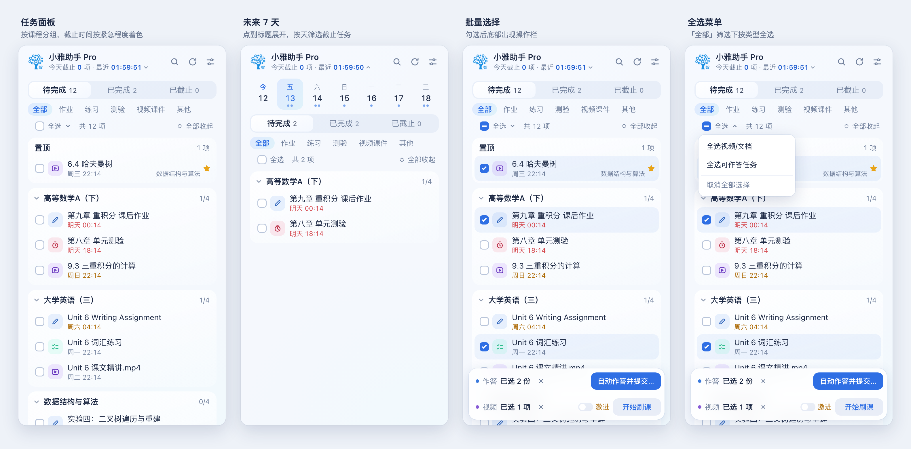
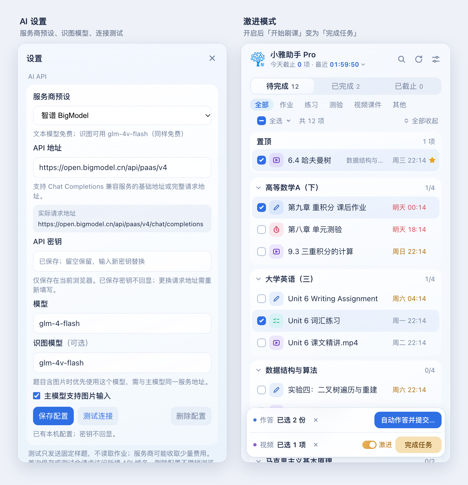
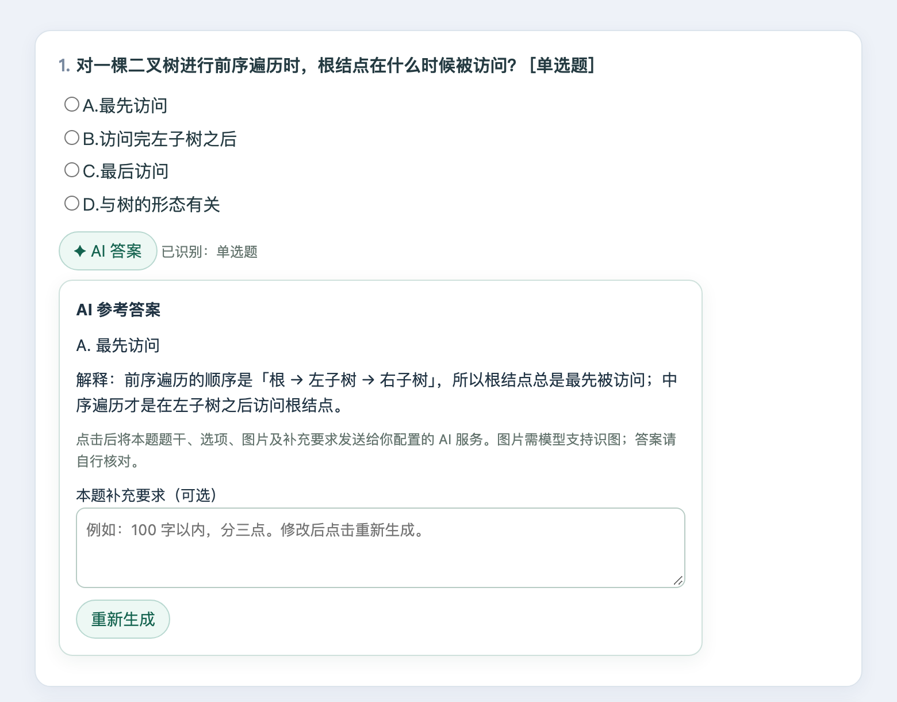
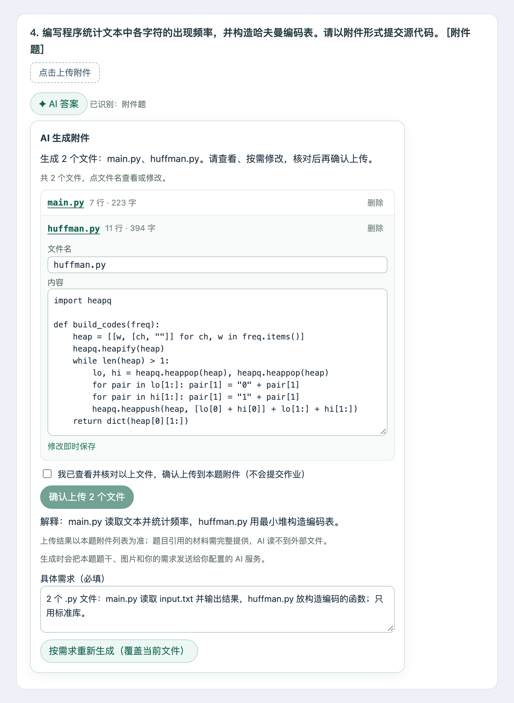

<div align="center">


# 小雅助手 Pro

**小雅课程平台的浏览器侧栏助手：任务一览、视频课件队列、个人 AI 答案与批量作答**

   

</div>

小雅助手 Pro 是一个 Chrome / Microsoft Edge 扩展。它在浏览器侧栏里汇总你在小雅（`whut.ai-augmented.com`）上的全部课程任务，可以按截止时间、类型和课程查看，批量处理视频与课件，用你自己的 AI 服务在题目旁给出参考答案，并在确认后整份作答提交。



> 截图使用虚构的示例课程，界面来自扩展真实代码。

## 目录

- [功能一览](#功能一览)
- [安装](#安装)
- [快速上手](#快速上手)
- [使用说明](#使用说明)
  - [任务面板](#任务面板)
  - [批量选择与底部操作栏](#批量选择与底部操作栏)
  - [视频与课件队列](#视频与课件队列)
  - [激进模式](#激进模式)
  - [AI 设置](#ai-设置)
  - [题旁 AI 答案](#题旁-ai-答案)
  - [附件题](#附件题)
  - [整份任务自动作答](#整份任务自动作答)
- [隐私与权限](#隐私与权限)
- [使用边界与已知限制](#使用边界与已知限制)
- [常见问题](#常见问题)
- [更新扩展](#更新扩展)
- [开发](#开发)
- [致谢](#致谢)
- [许可证](#许可证)
- [免责声明](#免责声明)

## 功能一览

| 功能 | 说明 |
| --- | --- |
| 任务面板 | 汇总当前学期全部课程的作业、练习、测验、视频课件，按课程、分类或时间排列，截止时间按紧急程度着色 |
| 未来 7 天 | 顶栏显示今天截止数和最近截止倒计时，展开后按天筛选 |
| 批量选择 | 列表栏三态全选；勾选后底部出现操作栏，作答与视频分行处理 |
| 视频与课件队列 | 按勾选顺序自动播放视频、停留课件，平台确认完成后进入下一项 |
| 激进模式 | 可选：直接向平台提交视频课件的完成状态，不打开播放页 |
| 个人 AI 配置 | 填写自己的 Chat Completions 兼容服务，内置智谱、DeepSeek 等 8 个服务商预设，可单独指定识图模型 |
| 题旁 AI 答案 | 在作业页面每题下方显示“✦ AI 答案”，点开才查询，只显示不填写 |
| 附件题 | 先写清需求，生成一个或多个文件，查看、修改后再确认上传；只上传，不提交作业 |
| 整份自动作答 | 勾选整份作业、练习、测验，确认清单后自动补全空题并提交 |
| 小窗口适配 | 窄面板自动换成两行布局，矮窗口收紧间距；遵循系统“减少动态效果”设置 |

## 安装

需要 **Chrome 或 Microsoft Edge 120 及以上版本**。安装不需要 npm，也不需要构建。

1. 从 [Releases](https://github.com/amamiyakazuki/xiaoya-pro/releases/latest) 下载最新版本的 ZIP，解压到一个**固定的**文件夹。以后更新会覆盖这个文件夹，不要放在“下载”或临时目录里。也可以直接下载本仓库源码。
2. 打开扩展管理页：
   - Chrome：地址栏输入 `chrome://extensions/`
   - Edge：地址栏输入 `edge://extensions/`
3. 打开 **开发者模式**（Chrome 在右上角，Edge 在左侧栏）。
4. 点击 **加载未打包的扩展程序**（英文界面为 *Load unpacked*），选择解压后的 **`extension` 文件夹**。不要选 ZIP 文件，也不要选仓库根目录。
5. 在工具栏的拼图图标里把“小雅助手 Pro”固定出来，点击图标打开侧栏。

Chrome 和 Edge 使用同一份代码和权限，不需要分别安装两个版本。两个浏览器的登录状态和扩展设置互相独立，在 Edge 里使用时需要在 Edge 里登录小雅。

## 快速上手

1. 在浏览器里打开并登录 [小雅](https://whut.ai-augmented.com/app/jx-web/mycourse)。
2. 点击工具栏的扩展图标打开侧栏，等待任务列表加载。面板会先显示上次的数据，再在后台刷新。
3. 想刷视频课件：勾选视频，点底部操作栏的 **开始刷课**。
4. 想用 AI：点右上角 ⚙ 打开设置，选择服务商预设，填入自己的 API 密钥，点 **测试连接**。
5. 打开任意作业页面，题目下方会出现 **✦ AI 答案**。

## 使用说明

### 任务面板

- **顶栏**：标题下方显示“今天截止 N 项 · 最近 倒计时”，点击展开未来 7 天的日历，再点某一天只看当天截止的任务。右侧是搜索、刷新和设置；鼠标停在刷新按钮上可以看到上次更新时间。
- **状态与类型**：上方切换 *待完成 / 已完成 / 已截止*，下方按 *作业、练习、测验、视频课件、其他* 筛选。筛选标签放不下时可以横向滚动。
- **列表栏**：左边是全选，中间是当前任务数，右边是 *全部收起 / 展开*。
- **任务行**：点击任务名跳转到对应页面。当前页是小雅且没有正在运行的队列时直接跳转，否则新开标签页。鼠标悬停可看开始时间和剩余时间，点星标置顶。
- **排列方式**：默认按课程分组，可以在设置里改为“分类”（课程内再按类型分组）或“时间”。

数据 5 分钟内不会重复请求，点刷新按钮立即读取。刷新需要至少开着一个已登录的小雅标签页；没有时面板显示上次的数据，并提示打开小雅。某门课读取失败时，其他课程照常显示，并提示数量可能不完整。

列表显示当前学期的全部课程，往期课程只有打开过才会显示。查看和跳转本身不会执行任何任务。

### 批量选择与底部操作栏

- 能自动处理的任务左侧有复选框：作业、练习、测验可以“作答”，视频与课件可以“刷课”。
- **列表栏的全选**有三种状态：未选、部分选中（显示 −）、全选。
  - 在“作业 / 练习 / 测验”或“视频课件”筛选下，点一下就全选当前筛选内可执行的项目。
  - 在“全部”筛选下会弹出菜单，可以选“全选视频/文档”或“全选可作答任务”。**不提供一键全选所有类型**，因为作答会直接提交，混在一起选容易误操作。
- **底部操作栏**只在有勾选、正在运行，或有未关闭的结果时出现：
  - 作答一行：已选份数、清空、**自动作答并提交…**
  - 视频一行：已选项数、清空、激进开关、**开始刷课 / 停止**
- 切换筛选不会丢失已选项目，筛选外的数量会显示为“（筛选外 N 项）”。

### 视频与课件队列

勾选视频或课件后，点底部操作栏的 **开始刷课**。当前是可用于刷课的小雅课程页时沿用该页，否则新开标签页。队列在同一个执行页里按勾选顺序逐项处理，平台确认完成后才打开下一项。

学习设置在 ⚙ 设置页里：

| 选项 | 作用 |
| --- | --- |
| 视频速度 | 1、1.25、1.5、2 倍速 |
| 课件停留时间 | 自动读取每份课件的时长要求，不需要填写 |
| 后台继续学习 | 刷课标签页在后台时继续运行，减少切换标签导致的暂停 |
| 静音自动播放 | 静音播放，避开浏览器的自动播放限制 |
| 完成后自动下一任务 | 平台确认完成后打开下一项；关闭则完成当前项后停止 |

完成与计时规则：

- 视频在实际播放到结尾后才请求完成。
- 课件通过平台的完成按钮获取时长条件。例如平台返回“已学习 17 秒，至少观看 2 分钟”，扩展会再等待剩余的 103 秒。每份课件单独计算。
- 页面显示平台确认的“已完成”后才进入下一项。
- 资源不匹配、无法识别时长、加载出错或需要验证时，队列暂停，并在操作栏的视频行显示原因。
- 支持 MP4、WebM、M4V、MOV、PPT/PPTX、PDF 和 Word。

关闭侧栏后队列继续运行，点视频行的 **停止** 可以暂停。

### 激进模式



激进模式默认关闭。开关在底部操作栏的视频行，勾选视频或文档后才会出现；开启前会弹窗提示：**通过此模式完成的任务不会增加相应的学习时长**。

开启后，“开始刷课”变成“完成任务”。点它并确认后，扩展用当前登录状态直接向平台提交完成，只发送课程 ID、节点 ID 和任务 ID，不打开播放页。

- 只处理未完成、未截止、身份完整（带任务 ID）的视频课件。
- 提交前按平台最新的任务列表复核；平台每确认一条，就从列表里移除一条；整批结束后再完整核对一次，逐项显示结果。
- **平台可能无法撤销这种完成记录**，请确认后再使用。

### AI 设置

在侧栏右上角 ⚙ 打开设置，填写自己的 **API 地址、密钥、模型**。每个人用自己的服务，没有共享密钥，也没有中转服务器。

- **服务商预设**：智谱 BigModel、DeepSeek、硅基流动、阿里百炼、火山方舟、Ollama（本地）、OpenRouter、Gemini。选好后自动填地址和推荐模型，再补上密钥即可；也可以选“自定义”。
- **识图模型（可选）**：题目含图片时优先用它，需要和主模型是同一个服务地址；留空则由主模型处理。如果取消勾选“主模型支持图片输入”，又没有填识图模型，含图题不会发送，会直接提示。
- **只支持 Chat Completions 协议**。填入 Anthropic Messages、OpenAI Responses 或 Gemini 原生地址时会明确报错。
- **地址补全**：根地址 `https://api.example.com` 会补成 `/v1/chat/completions`；`https://api.example.com/v1` 会追加 `/chat/completions`；完整地址不会重复追加。以设置页显示的“实际请求地址”为准。
- 必须是 HTTPS；本机服务可以用 `http://localhost:端口/v1` 或 `http://127.0.0.1:端口/v1`。
- **密钥**：保存后不回显，留空表示保留原密钥。更换请求地址时必须重新填写，防止旧密钥被发到另一个服务。
- **测试连接**：用当前表单发送一道固定样题，不读取作业，也不保存配置；超时 25 秒，可以取消。服务商可能按调用收费。
- 保存或测试时，浏览器才会请求访问你填写的那个域名，拒绝授权就不会保存或发送。

### 题旁 AI 答案



> 图中答案为演示用的模拟内容。

保存 AI 配置后，小雅作业相关页面的每道题下方会出现 **✦ AI 答案**。点开才会发送这道题并显示答案和简短解释，**只显示，不会填写或提交**。

- 支持单选、多选、填空、判断、简答、论述/计算，附件题，组合题和图片。填空题按空位编号显示答案。
- 附件题的流程不同，见下一节 [附件题](#附件题)。
- 每题可以填写“本题补充要求”，例如“100 字以内，分三点”，点 **重新生成** 后生效，最多 2000 字。
- **流式输出**：查询时显示「整理题目 › 等待响应 › 思考 › 生成 › 整理答案」进度和已用时间，生成过程中实时预览答案正文，卡住时能看出停在哪一步。
- 同一时间只处理一个请求。服务首次响应、以及生成过程中两段内容之间，普通题最多等 25 秒、附件题 60 秒；持续输出时不会被打断，总时长上限为普通题 2 分钟、附件题 4.5 分钟。可以取消或手动重试，不会自动重试。
- 单题最多 8 张图片，单张不超过 4 MB，合计不超过 16 MB；图片准备超过 15 秒会停止。图片读取失败时整题不发送，不会省略图片硬答。
- 支持可提取的 LaTeX / MathML 公式；嵌入的音视频、外部 PDF/Word 等材料暂不读取。
- 扩展更新后，已经打开的小雅页面需要刷新才能用上新版浮标，请先保存自己的草稿。

### 附件题



> 图中文件为演示用的模拟内容。

附件题比较特殊，点开 **✦ AI 答案** 后不会马上生成，而是分四步，每一步都需要你自己确认。**建议附件题尽量自己完成并上传**，AI 生成的内容请务必核对。

1. **写清需求**（必填）：需要几个文件、什么类型、文件名，以及用到的语言或库，例如「2 个 .py 文件：main.py 读取 input.txt 并输出结果，huffman.py 放构造编码的函数；只用标准库」。写好后点 **确认需求，开始生成**。
2. **生成**：和普通题一样显示进度，实时预览正在写的文件。最多 5 个文件，单个文件不超过 6 万字。
3. **查看与修改**：列出生成的文件和行数、字数。点文件名展开编辑器，可以改文件名和内容，**修改即时保存**；不需要的文件可以删除。需求不满意可以改完需求后 **按需求重新生成**，会覆盖当前文件。
4. **确认上传**：勾选「我已查看并核对以上文件」后，点 **确认上传 N 个文件**，逐个写入本题附件控件，并显示每个文件的上传结果。同名的旧附件会先删除。**只上传附件，不会提交作业**；上传结果以本题附件列表为准，可以在列表里删除。

文件名只能用字母、数字和 `._-`，必须带扩展名，不能包含路径。修改的内容在刷新页面前一直保留。一键自动作答批次仍然跳过附件题。

### 整份任务自动作答

1. 在侧栏按作业、练习或测验筛选，勾选整份任务（默认一个都不选）。
2. 点底部操作栏的 **自动作答并提交…**，检查完整清单（包括筛选外的已选任务），确认后开始。
3. 扩展在独立的执行页里读取整卷、查询空题、填写并提交，按平台回执逐份显示结果。

规则：

- **保留已有的人工答案，只补空题**。
- 含附件题时跳过附件题，其余题目填好后标记为“待补附件”，**不自动提交**，保留原答题页，继续下一份。
- 其他题目无法可靠填写时，整份标记为“待处理”。
- 提交前核对答题卡与填写内容。提交弹窗里确有未答题、加载超时或弹窗无法识别时，批次暂停并说明题号或原因。
- 提交结果不明时整批暂停、不会重交；点 **核对提交结果** 会读取平台最新状态。
- 只能提交一次的任务同样会在确认后执行，请仔细核对清单。

目前能自动填写文字单选、多选、填空和普通文本框；富文本编辑器、图片题、判断题、组合题的自动填写尚未支持。附件题的上传只在题旁浮标提供，一键批次仍跳过附件题。

批次结束后，结果留在底部操作栏，可以点 × 关闭。超过 24 小时，或其中任务都已完成的结果会自动隐藏。

视频队列和作答批次可以同时运行，各用各的执行页，可以分别停止。

## 隐私与权限

| 权限 | 用途 |
| --- | --- |
| `whut.ai-augmented.com` | 读取任务、打开资源、在作业页显示浮标 |
| `storage` | 保存设置、任务缓存和会话状态 |
| `alarms` | 定时唤醒队列 |
| `sidePanel` | 显示任务面板 |
| `scripting` | 检查并补载页面脚本，从已打开的小雅页面读取登录状态 |
| 可选：所填 AI 服务域名 | 只在你点“保存配置”或“测试连接”时，按你填的域名单独申请 |

- **不读取、不保存登录密码**。任务面板会读取小雅页面的登录凭据来请求任务数据，只发给小雅，不写入本地存储。
- **AI 请求只发送必要内容**：题干、选项、题型、所需图片和补充要求，不发送你已有的答案，也不携带小雅的登录凭据或 Cookie，不跟随重定向。
- **AI 配置只存在本机**扩展存储中，不云同步，也不额外加密；网页脚本读不到，设置页只知道“密钥已保存”。密钥不会写进日志或队列状态。
- 最近 40 条日志保存在当前浏览器会话中；切换小雅账号时清空任务缓存。

## 使用边界与已知限制

- 运行期间请保持浏览器打开、电脑不休眠，不要刷新、关闭或手动跳转正在执行任务的小雅标签页。平台提示刷新或离开任务页时，可能会重置连续计时。
- 后台模式会处理页面可见性和焦点检测，并在运行期间关闭该标签页的自动休眠，停止后恢复；它防不了系统休眠、浏览器崩溃或服务端限制。
- **真实平台上的完整课程流程和后台有效计时尚未完成端到端验证，不能保证所有课程都有效。** 平台在多个标签页同时播放时是否累计学习时长也未实测。
- 视频队列状态保存在当前浏览器会话中，退出浏览器后需要重新开始。
- AI 答案的正确率取决于你使用的模型，请自行核对。
- Edge 的真实平台流程尚未完整验证。

## 常见问题

<details>
<summary><b>侧栏一直提示打开小雅 / 任务不更新</b></summary>

刷新任务需要至少开着一个已登录的小雅标签页。打开 <https://whut.ai-augmented.com/app/jx-web/mycourse> 并登录后，面板会自动重新读取。

</details>

<details>
<summary><b>更新扩展后看起来没变化</b></summary>

在扩展管理页点“小雅助手 Pro”的“重新加载”，然后关掉侧栏重新打开。题旁浮标需要刷新已打开的作业页面才会更新，刷新前请先保存草稿。

</details>

<details>
<summary><b>底部操作栏一直显示上一批的作答结果</b></summary>

点作答行的 × 即可关闭。超过 24 小时，或其中任务已全部完成的结果会自动隐藏。

</details>

<details>
<summary><b>测试连接报“协议不支持”</b></summary>

扩展只支持 Chat Completions 兼容接口。请改用服务商提供的 OpenAI 兼容地址，例如阿里百炼要填 `compatible-mode/v1` 那个地址。

</details>

<details>
<summary><b>有的任务不能勾选</b></summary>

- 视频课件的复选框变灰时，鼠标停在上面可以看到原因，常见的有：已完成、已截止、尚未开放、任务标识不完整。
- 作业、练习、测验如果没有复选框，说明它已完成，或者任务信息不完整，暂时不能自动作答。
- 队列或作答批次运行中，所有复选框都会暂时锁定。

</details>

## 更新扩展

1. 先结束当前批次，保存自己的草稿。
2. 下载新版 ZIP，用新的 `extension` 文件夹**覆盖**原来加载的那个文件夹（路径不变）。
3. 在 `chrome://extensions/` 或 `edge://extensions/` 找到“小雅助手 Pro”，点击 **重新加载**，再重开侧栏。

每个版本的改动见 [更新记录](CHANGELOG.md)。

## 开发

不需要构建步骤，直接加载 `extension` 目录即可开发；修改后在扩展管理页重新加载，并刷新小雅页面。

```text
extension/
├── manifest.json        扩展清单（Manifest V3）
├── worker.js            后台：队列调度、消息路由
├── sidepanel.*          侧栏页面与样式
├── panel-*.js           侧栏模块：数据模型、作答、视频队列、全选与动效、AI 设置
├── task-data.js         任务读取、缓存与平台接口
├── content.js           页面脚本：视频播放、课件计时
├── background-mode.js   后台播放支持
├── answer-*.js          题目识别、浮标、批量作答驱动
└── ai-*.js              AI 地址解析、请求与题目整理
tests/                   Node.js 内置测试运行器的回归测试
scripts/package.ps1      生成 Chrome / Edge 安装包
```

运行测试（需要 Node.js）：

```sh
npm ci
npm test
```

测试覆盖任务读取与缓存、面板筛选排序、队列启动与停止、激进模式、平台时长解析、后台模式、AI 地址解析与密钥隔离、题型识别、批量作答流程等。`linkedom` 只是开发测试依赖，安装扩展不需要它。**模拟测试通过不等于真实平台验证。**

生成安装包（PowerShell）：

```powershell
./scripts/package.ps1 -Browser all     # 或 -Browser chrome / -Browser edge
```

输出在 `dist/`，该目录不提交到 Git。

## 致谢

本项目最早基于 [xiaoze123kk/xiaoya-course-helper](https://github.com/xiaoze123kk/xiaoya-course-helper) 开发，并完整保留了原 Git 历史。视频课件播放与计时的早期实现来自该项目，感谢原作者。

## 许可证

本项目以 [GNU Affero General Public License v3.0](LICENSE) 发布。

## 免责声明

本项目仅供学习和研究浏览器扩展开发使用，与小雅平台及其运营方没有任何关系。

- 自动播放、直接完成和自动作答可能违反学校的课程规定或平台的用户协议，**使用前请确认所在课程允许**，后果由使用者自行承担。
- 直接完成和自动提交的记录可能无法撤销；AI 答案可能有错，请自行核对。
- 作者不对因使用本项目造成的成绩、账号或其他损失负责。
